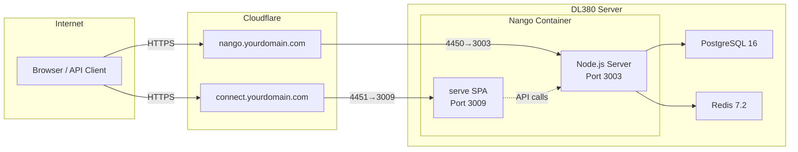

# Nango Self-Hosted — Standard Operating Procedures

> [!IMPORTANT]
> This SOP covers the complete lifecycle of managing OAuth integrations in Nango self-hosted (v0.72.6) on Coolify behind Cloudflare Tunnel.

## Architecture Overview



## Quick Reference

| Item | Value |
|------|-------|
| **Dashboard URL** | `https://nango.yourdomain.com` |
| **Connect UI URL** | `https://connect.yourdomain.com` |
| **Dashboard Login** | `<YOUR_EMAIL>` / `<YOUR_DASHBOARD_PASSWORD>` |
| **API (Dev key)** | `<YOUR_NANGO_DEV_KEY>` |
| **API (Prod key)** | `<YOUR_NANGO_PROD_KEY>` |
| **API Base Path** | Root (`/integrations`, NOT `/api/v1/`) |
| **OAuth Callback** | `https://nango.yourdomain.com/oauth/callback` |
| **Coolify UUID** | `<YOUR_COOLIFY_UUID>` |
| **Cloudflare Tunnel** | `<YOUR_TUNNEL_ID>` |

---

## SOP 1: Adding a New OAuth Integration

### Step 1 — Find the Provider in Nango's Catalog

```bash
# Search providers
curl -s 'https://nango.yourdomain.com/providers?search=google' \
  -H 'Authorization: Bearer <YOUR_NANGO_DEV_KEY>' | python3 -m json.tool
```

Or use the dashboard: **Catalog** → search for the provider.

### Step 2 — Create OAuth Credentials in the Provider's Developer Console

For Google services (Gmail, Calendar, Drive, etc.):
1. Go to [Google Cloud Console → APIs & Services → Credentials](https://console.cloud.google.com/apis/credentials)
2. Create an **OAuth 2.0 Client ID** (Web Application type)
3. Set **Authorized redirect URI** to: `https://nango.yourdomain.com/oauth/callback`
4. Note the **Client ID** and **Client Secret**

> [!WARNING]
> The redirect URI MUST be exactly `https://nango.yourdomain.com/oauth/callback` — no trailing slash, no different domain.

### Step 3 — Configure the Integration in Nango Dashboard

1. Go to `https://nango.yourdomain.com` → **Integrations**
2. Click **+ Add Integration**
3. Select the provider (e.g., `google-mail`, `google-calendar`)
4. Enter:
   - **Integration Unique Key**: e.g., `google-mail`, `google-calendar`
   - **Client ID**: from Step 2
   - **Client Secret**: from Step 2
   - **Scopes**: as needed (e.g., `https://www.googleapis.com/auth/gmail.readonly`)
5. Save

### Step 4 — Verify the Integration

```bash
curl -s 'https://nango.yourdomain.com/integrations' \
  -H 'Authorization: Bearer <YOUR_NANGO_DEV_KEY>' | python3 -m json.tool
```

---

## SOP 2: Creating an OAuth Connection

### Method A — Via Dashboard "Connect" Button (Primary)

1. Go to `https://nango.yourdomain.com` → **Connections** → **+ Add Connection**
2. Select the integration (e.g., `google-mail`)
3. Click **Connect**
4. A popup opens at `https://connect.yourdomain.com/?session_token=...`
5. Select the integration and authorize with the provider (Google, etc.)
6. The popup closes and the connection appears in the list

### Method B — Via API (Programmatic / Fallback)

Use this when:
- Connecting from an automated workflow
- Dashboard popup is blocked by browser
- Creating connections for end users in your app

```bash
# 1. Create a connect session
DEV_KEY="<YOUR_NANGO_DEV_KEY>"
curl -s -X POST 'https://nango.yourdomain.com/connect/sessions' \
  -H "Authorization: Bearer $DEV_KEY" \
  -H "Content-Type: application/json" \
  -d '{
    "end_user": {
      "id": "<YOUR_USER_ID>",
      "display_name": "<YOUR_NAME>",
      "email": "<YOUR_EMAIL>"
    },
    "allowed_integrations": ["google-calendar"]
  }'

# Response includes:
# "connect_link": "https://connect.yourdomain.com/?session_token=nango_connect_session_..."

# 2. Open the connect_link in a browser to authorize
# 3. Verify the connection was created
curl -s 'https://nango.yourdomain.com/connections' \
  -H "Authorization: Bearer $DEV_KEY" | python3 -m json.tool
```

### Method C — Direct OAuth URL (Low-Level)

```bash
# Requires a connect session token first (from Method B step 1)
# Then construct the direct OAuth URL:
open "https://nango.yourdomain.com/oauth/connect/google-calendar?connect_session_token=<TOKEN>"
```

> [!CAUTION]
> Do NOT pass `connection_id` as a query parameter when using `connect_session_token` — it will be rejected with `connection_id is forbidden when using session token`.

---

## SOP 3: Using Nango Proxy to Call APIs

Once a connection exists, use Nango's proxy to make authenticated API calls without handling tokens yourself.

### Gmail — List Last 5 Emails

```bash
DEV_KEY="<YOUR_NANGO_DEV_KEY>"

# List messages
curl -s 'https://nango.yourdomain.com/proxy/gmail/v1/users/me/messages?maxResults=5' \
  -H "Authorization: Bearer $DEV_KEY" \
  -H "Connection-Id: <connection_id>" \
  -H "Provider-Config-Key: google-mail" | python3 -m json.tool

# Get a specific message
MSG_ID="<message_id_from_above>"
curl -s "https://nango.yourdomain.com/proxy/gmail/v1/users/me/messages/$MSG_ID" \
  -H "Authorization: Bearer $DEV_KEY" \
  -H "Connection-Id: <connection_id>" \
  -H "Provider-Config-Key: google-mail" | python3 -m json.tool
```

### Google Calendar — List Events

```bash
curl -s 'https://nango.yourdomain.com/proxy/calendar/v3/calendars/primary/events?maxResults=10&orderBy=startTime&singleEvents=true' \
  -H "Authorization: Bearer $DEV_KEY" \
  -H "Connection-Id: <connection_id>" \
  -H "Provider-Config-Key: google-calendar" | python3 -m json.tool
```

### Proxy Headers Reference

| Header | Required | Description |
|--------|----------|-------------|
| `Authorization` | Yes | `Bearer <api_key>` |
| `Connection-Id` | Yes | The connection UUID or end_user_id |
| `Provider-Config-Key` | Yes | The integration key (e.g., `google-mail`) |

> [!TIP]
> Nango automatically handles OAuth token refresh. If a token is expired, the proxy will refresh it transparently before making the API call.

---

## SOP 4: Managing API Keys

### Viewing Keys

- **Dashboard:** Settings → Environment → Secret Key
- **API:** Keys are stored encrypted in the `customer_keys` table (AES-256-GCM)
- **`.env.local`:** Contains `NANGO_API_DEV` and `NANGO_API_PROD`

### Key Architecture

```
Request with Bearer token
  → PBKDF2 hash (310,000 iterations, SHA-256)
  → Lookup in customer_keys table by hash
  → Returns account_id → resolves to environment
```

### Environment Separation

| Environment | Key | env_id | Use |
|-------------|-----|--------|-----|
| Dev | `<DEV_KEY>` | 6 | Testing integrations |
| Prod | `<PROD_KEY>` | 5 | Production connections |

> [!NOTE]
> Dev and Prod environments have separate integrations and connections. An integration configured in Dev is NOT visible in Prod. Use the toggle in the dashboard top-left corner to switch environments.

---

## SOP 5: Troubleshooting

### "Connect" Button Does Nothing / Redirects to Catalog

**Cause:** Connect UI not reachable or `connectUrl` misconfigured.

**Check:**
```bash
# 1. Verify Connect UI is serving
curl -s -o /dev/null -w "%{http_code}" "https://connect.yourdomain.com/"
# Should return 200

# 2. Verify env.js has correct connectUrl
curl -s "https://nango.yourdomain.com/env.js?t=$(date +%s)" | grep connectUrl
# Should show: "connectUrl": "https://connect.yourdomain.com"

# 3. Verify both ports are listening inside container
ssh dl380-vps 'docker exec nango-server-<YOUR_COOLIFY_UUID> cat /proc/net/tcp6 | head -5'
# Should show 0x0BBB (3003) and 0x0BC1 (3009)
```

**Fix:** If port 3009 is not mapped, update docker-compose.yml to add `<YOUR_HOST_IP>:4451:3009`.

### API Returns 401 Unauthorized

**Common causes:**
1. Using wrong endpoint path (`/api/v1/*` instead of root `/`)
2. Using wrong environment key (dev key on prod, or vice versa)
3. Key has been rotated

**Check:**
```bash
# Test with root path
curl -s -o /dev/null -w "%{http_code}" 'https://nango.yourdomain.com/integrations' \
  -H 'Authorization: Bearer <YOUR_NANGO_DEV_KEY>'
# Should return 200
```

### OAuth Callback Fails

**Check:** Google Cloud Console → APIs & Services → Credentials → OAuth 2.0 Client
- Authorized redirect URI must be: `https://nango.yourdomain.com/oauth/callback`
- No Cloudflare Access policies should intercept the callback

### Browser Login Fails

**Check:**
1. `NANGO_SERVER_URL` must be `https://nango.yourdomain.com` (not `http://localhost:3003`)
2. Clear browser cache / open in incognito
3. Check rate limiting: If too many failed attempts, wait a few minutes

---

## SOP 6: Maintenance

### Restart Nango

```bash
ssh dl380-vps 'cd /data/coolify/services/<YOUR_COOLIFY_UUID> && docker compose restart nango-server'
```

### Full Redeploy (after compose changes)

```bash
ssh dl380-vps 'cd /data/coolify/services/<YOUR_COOLIFY_UUID> && docker compose down && docker compose up -d'
```

### View Logs

```bash
ssh dl380-vps 'docker logs nango-server-<YOUR_COOLIFY_UUID> --tail 50 -f'
```

### Database Access

```bash
ssh dl380-vps 'docker exec -it nango-db-<YOUR_COOLIFY_UUID> psql -U nango -d nango'
```

### Backup Database

```bash
ssh dl380-vps 'docker exec nango-db-<YOUR_COOLIFY_UUID> pg_dump -U nango nango > /data/backups/nango-$(date +%Y%m%d).sql'
```

### Check Health

```bash
curl -s 'https://nango.yourdomain.com/health'
# Returns: {"result":"ok"}
```

---

## SOP 7: Platform Integrations

Nango serves as a **unified OAuth hub** — configure OAuth once in Nango, then consume tokens or proxy calls from any platform. Two integration modes:

| Mode | How it works | Best for |
|------|-------------|----------|
| **Proxy** | Route API calls through `nango.yourdomain.com/proxy/...` | Platforms that can set custom headers (n8n, scripts) |
| **Token** | Fetch a fresh OAuth token from Nango, use it directly | Platforms that need a raw `Bearer` token (MCP servers, SDKs) |

### Integration Pattern: Token Retrieval

```bash
# Get a fresh OAuth access token from any connection
# Nango auto-refreshes expired tokens on each call
curl -s 'https://nango.yourdomain.com/connections/<CONNECTION_ID>?provider_config_key=<PROVIDER_KEY>' \
  -H 'Authorization: Bearer <NANGO_API_KEY>' \
  | jq -r '.credentials.access_token'
```

**Active connections:**

| Provider | Connection ID | Provider Config Key |
|----------|--------------|---------------------|
| Gmail | `<YOUR_GMAIL_CONNECTION_ID>` | `google-mail` |
| Calendar | `<YOUR_CALENDAR_CONNECTION_ID>` | `google-calendar` |

---

### 7.1 — n8n (Workflow Automation)

n8n can consume Nango connections in two ways: **Proxy mode** (recommended) or **Token mode**.

#### Method A: Proxy via HTTP Request Node (Recommended)

Create an **HTTP Request** node that routes calls through Nango's proxy:

| Setting | Value |
|---------|-------|
| **Method** | `GET` (or as needed) |
| **URL** | `https://nango.yourdomain.com/proxy/gmail/v1/users/me/messages?maxResults=5` |
| **Authentication** | Header Auth |
| **Header Auth — Name** | `Authorization` |
| **Header Auth — Value** | `Bearer <YOUR_NANGO_DEV_KEY>` |

**Additional headers** (Send Headers → Add Header):

| Name | Value |
|------|-------|
| `Connection-Id` | `<YOUR_GMAIL_CONNECTION_ID>` |
| `Provider-Config-Key` | `google-mail` |

> [!TIP]
> Store the Nango API key as an n8n credential (Header Auth type) so you don't hardcode it in every node.

#### Method B: Token Fetch + Direct API Call

Use two nodes chained:

1. **HTTP Request** node — fetch token from Nango:
   - URL: `https://nango.yourdomain.com/connections/<YOUR_GMAIL_CONNECTION_ID>?provider_config_key=google-mail`
   - Header: `Authorization: Bearer <NANGO_KEY>`

2. **HTTP Request** node — call Google API directly:
   - URL: `https://gmail.googleapis.com/gmail/v1/users/me/messages?maxResults=5`
   - Header: `Authorization: Bearer {{ $json.credentials.access_token }}`

#### n8n Sub-Workflow Pattern

Create a reusable sub-workflow `Nango: Get Token` that:
1. Accepts `connection_id` and `provider_config_key` as inputs
2. Calls the Nango token endpoint
3. Returns the fresh `access_token`
4. Any workflow can call this sub-workflow before making API calls

```
[Manual/Webhook Trigger] → [HTTP: Nango Token] → [Set: Extract Token] → [Respond]
```

#### Example: Gmail Summary Workflow

```
[Schedule Trigger (daily 9am)]
  → [HTTP Request: Nango Proxy - List 5 messages]
  → [SplitInBatches]
  → [HTTP Request: Nango Proxy - Get message detail]
  → [AI Agent: Summarize emails]
  → [Telegram: Send summary]
```

**Proxy URLs for n8n:**

| Service | Proxy URL |
|---------|-----------|
| Gmail — List messages | `https://nango.yourdomain.com/proxy/gmail/v1/users/me/messages` |
| Gmail — Get message | `https://nango.yourdomain.com/proxy/gmail/v1/users/me/messages/{{$json.id}}` |
| Gmail — Send message | `POST https://nango.yourdomain.com/proxy/gmail/v1/users/me/messages/send` |
| Calendar — List events | `https://nango.yourdomain.com/proxy/calendar/v3/calendars/primary/events` |
| Calendar — Create event | `POST https://nango.yourdomain.com/proxy/calendar/v3/calendars/primary/events` |

---

### 7.2 — Antigravity (Google AI Agent)

Antigravity can call Nango's API directly via `run_command` with `curl`.

#### Using Nango Proxy

```bash
# In any Antigravity session — read Gmail
curl -s 'https://nango.yourdomain.com/proxy/gmail/v1/users/me/messages?maxResults=5' \
  -H 'Authorization: Bearer <YOUR_NANGO_DEV_KEY>' \
  -H 'Connection-Id: <YOUR_GMAIL_CONNECTION_ID>' \
  -H 'Provider-Config-Key: google-mail'

# Read Calendar events
curl -s 'https://nango.yourdomain.com/proxy/calendar/v3/calendars/primary/events?maxResults=10&orderBy=startTime&singleEvents=true&timeMin=2026-11-20T00:00:00Z' \
  -H 'Authorization: Bearer <YOUR_NANGO_DEV_KEY>' \
  -H 'Connection-Id: <YOUR_CALENDAR_CONNECTION_ID>' \
  -H 'Provider-Config-Key: google-calendar'
```

#### Using as an MCP Server

Nango has built-in MCP support. Configure it in Antigravity's MCP config:

```json
{
  "mcpServers": {
    "nango": {
      "command": "npx",
      "args": ["-y", "@nangohq/mcp"],
      "env": {
        "NANGO_SECRET_KEY": "<YOUR_NANGO_DEV_KEY>",
        "NANGO_BASE_URL": "https://nango.yourdomain.com",
        "CONNECTION_ID": "<YOUR_GMAIL_CONNECTION_ID>"
      }
    }
  }
}
```

> [!NOTE]
> The `@nangohq/mcp` package exposes all Nango-connected APIs as MCP tools. Each integration's syncs and actions become callable tools.

#### Credential Reference in `.env.local`

Antigravity already has these configured:

```
NANGO_API_DEV: <YOUR_NANGO_DEV_KEY>
NANGO_API_PROD: <YOUR_NANGO_PROD_KEY>
NANGO_HOST: https://nango.yourdomain.com
```

---

### 7.3 — Claude Code (Anthropic AI Agent)

Claude Code can use Nango via MCP or direct shell commands.

#### MCP Server Configuration

Add to `~/.claude/claude_desktop_config.json` or `.mcp.json` in your project:

```json
{
  "mcpServers": {
    "nango-gmail": {
      "command": "npx",
      "args": ["-y", "@nangohq/mcp"],
      "env": {
        "NANGO_SECRET_KEY": "<YOUR_NANGO_DEV_KEY>",
        "NANGO_BASE_URL": "https://nango.yourdomain.com",
        "CONNECTION_ID": "<YOUR_GMAIL_CONNECTION_ID>"
      }
    },
    "nango-calendar": {
      "command": "npx",
      "args": ["-y", "@nangohq/mcp"],
      "env": {
        "NANGO_SECRET_KEY": "<YOUR_NANGO_DEV_KEY>",
        "NANGO_BASE_URL": "https://nango.yourdomain.com",
        "CONNECTION_ID": "<YOUR_CALENDAR_CONNECTION_ID>"
      }
    }
  }
}
```

#### Shell Commands (via `run_command`)

Same `curl` commands as Antigravity — Claude Code has shell access:

```bash
# Fetch token and use directly
TOKEN=$(curl -s 'https://nango.yourdomain.com/connections/<YOUR_GMAIL_CONNECTION_ID>?provider_config_key=google-mail' \
  -H 'Authorization: Bearer <YOUR_NANGO_DEV_KEY>' | jq -r '.credentials.access_token')

curl -s "https://gmail.googleapis.com/gmail/v1/users/me/messages?maxResults=5" \
  -H "Authorization: Bearer $TOKEN"
```

---

### 7.4 — Codex (OpenAI AI Agent)

Codex operates in a sandboxed environment. Use the MCP or HTTP approach.

#### MCP Server Configuration

Add to your Codex MCP config (`.codex/mcp.json`):

```json
{
  "mcpServers": {
    "nango": {
      "command": "npx",
      "args": ["-y", "@nangohq/mcp"],
      "env": {
        "NANGO_SECRET_KEY": "<YOUR_NANGO_DEV_KEY>",
        "NANGO_BASE_URL": "https://nango.yourdomain.com",
        "CONNECTION_ID": "<YOUR_GMAIL_CONNECTION_ID>"
      }
    }
  }
}
```

#### Direct API (if shell access available)

Same `curl` patterns as other agents — use Nango proxy or token fetch.

> [!WARNING]
> Codex runs in a network-restricted sandbox by default. The Nango MCP server must be whitelisted for outbound access to `nango.yourdomain.com`, or you need to run Codex in a mode that allows network access.

---

### 7.5 — OpenMausBot

OpenMausBot bots can use Nango to authenticate with Google APIs for email reading, calendar checking, etc.

#### Bot Action / Script Integration

In a bot's custom action or JavaScript code:

```javascript
// Fetch a fresh token from Nango
const nangoKey = '<YOUR_NANGO_DEV_KEY>';
const connectionId = '<YOUR_GMAIL_CONNECTION_ID>';

const tokenRes = await fetch(
  `https://nango.yourdomain.com/connections/${connectionId}?provider_config_key=google-mail`,
  { headers: { 'Authorization': `Bearer ${nangoKey}` } }
);
const { credentials } = await tokenRes.json();

// Use the token to call Gmail directly
const gmailRes = await fetch(
  'https://gmail.googleapis.com/gmail/v1/users/me/messages?maxResults=5',
  { headers: { 'Authorization': `Bearer ${credentials.access_token}` } }
);
const emails = await gmailRes.json();
```

#### Using Nango Proxy (simpler)

```javascript
const res = await fetch(
  'https://nango.yourdomain.com/proxy/gmail/v1/users/me/messages?maxResults=5',
  {
    headers: {
      'Authorization': 'Bearer <YOUR_NANGO_DEV_KEY>',
      'Connection-Id': '<YOUR_GMAIL_CONNECTION_ID>',
      'Provider-Config-Key': 'google-mail'
    }
  }
);
```

#### Environment Variables

Add to the OpenMausBot container environment (Coolify):
```yaml
NANGO_API_KEY: '<YOUR_NANGO_DEV_KEY>'
NANGO_HOST: 'https://nango.yourdomain.com'
```

---

### 7.6 — Custom Scripts & CLI Tools

For any script, cron job, or CLI tool:

#### One-Liner: Get Gmail Summary

```bash
#!/bin/bash
NANGO_KEY="<YOUR_NANGO_DEV_KEY>"
NANGO_HOST="https://nango.yourdomain.com"

# List latest 5 messages via proxy
curl -s "$NANGO_HOST/proxy/gmail/v1/users/me/messages?maxResults=5" \
  -H "Authorization: Bearer $NANGO_KEY" \
  -H "Connection-Id: <YOUR_GMAIL_CONNECTION_ID>" \
  -H "Provider-Config-Key: google-mail" \
  | jq -r '.messages[].id' \
  | while read MSG_ID; do
      curl -s "$NANGO_HOST/proxy/gmail/v1/users/me/messages/$MSG_ID?format=metadata&metadataHeaders=Subject&metadataHeaders=From" \
        -H "Authorization: Bearer $NANGO_KEY" \
        -H "Connection-Id: <YOUR_GMAIL_CONNECTION_ID>" \
        -H "Provider-Config-Key: google-mail" \
        | jq -r '[.payload.headers[] | {(.name): .value}] | add | "\(.From // "?") — \(.Subject // "No subject")"'
    done
```

#### Python Helper

```python
import requests

class NangoClient:
    def __init__(self, api_key, host="https://nango.yourdomain.com"):
        self.api_key = api_key
        self.host = host
        self.headers = {"Authorization": f"Bearer {api_key}"}

    def get_token(self, connection_id, provider_config_key):
        """Fetch a fresh OAuth token (auto-refreshed by Nango)."""
        r = requests.get(
            f"{self.host}/connections/{connection_id}",
            params={"provider_config_key": provider_config_key},
            headers=self.headers
        )
        return r.json()["credentials"]["access_token"]

    def proxy(self, method, path, connection_id, provider_config_key, **kwargs):
        """Route an API call through the Nango proxy."""
        headers = {
            **self.headers,
            "Connection-Id": connection_id,
            "Provider-Config-Key": provider_config_key,
        }
        return requests.request(method, f"{self.host}/proxy/{path}", headers=headers, **kwargs)

# Usage
nango = NangoClient("<YOUR_NANGO_DEV_KEY>")
emails = nango.proxy("GET", "gmail/v1/users/me/messages?maxResults=5",
    connection_id="<YOUR_GMAIL_CONNECTION_ID>",
    provider_config_key="google-mail").json()
```

---

### Platform Integration Quick Reference

| Platform | Best Method | Config Location | Notes |
|----------|------------|-----------------|-------|
| **n8n** | HTTP Request + Proxy | Workflow nodes | Use Header Auth credential for Nango key |
| **Antigravity** | curl / MCP | `.env.local` + MCP config | Keys already in `.env.local` |
| **Claude Code** | MCP / curl | `.mcp.json` or `claude_desktop_config.json` | One MCP server per connection |
| **Codex** | MCP / curl | `.codex/mcp.json` | Needs network access to `nango.yourdomain.com` |
| **OpenMausBot** | fetch() in bot script | Container env vars | Use proxy mode for simplicity |
| **Scripts / Cron** | curl / Python | Shell env vars | Python helper class available |

---

## Infrastructure Details

### Docker Compose (key sections)

```yaml
services:
  nango-server:
    image: nangohq/nango-server:hosted
    ports:
      - '<YOUR_HOST_IP>:4450:3003'  # Dashboard + API
      - '<YOUR_HOST_IP>:4451:3009'  # Connect UI
    environment:
      NANGO_SERVER_URL: 'https://nango.yourdomain.com'
      NANGO_PUBLIC_SERVER_URL: 'https://nango.yourdomain.com'
      NANGO_PUBLIC_CONNECT_URL: 'https://connect.yourdomain.com'
      FLAG_SERVE_CONNECT_UI: 'true'
      NANGO_CONNECT_UI_PORT: 3009
      FLAG_AUTH_ENABLED: 'true'
```

### Cloudflare Tunnel Routes

| Hostname | Backend |
|----------|---------|
| `nango.yourdomain.com` | `http://<YOUR_HOST_IP>:4450` |
| `connect.yourdomain.com` | `http://<YOUR_HOST_IP>:4451` |

### DNS Records

| Record | Type | Content |
|--------|------|---------|
| `nango.yourdomain.com` | CNAME | `96b6485b-...cfargotunnel.com` (proxied) |
| `connect.yourdomain.com` | CNAME | `96b6485b-...cfargotunnel.com` (proxied) |
